[⏱ Lectura: 7 minutos]{.lectura}

Esta guía muestra cómo armar una encuesta en Google Forms que después se pueda analizar sin problemas. Todas las capturas vienen de un formulario de ejemplo, la *Encuesta de hábitos de estudio*. Haz clic en cualquier imagen para ampliarla.

## Crear el formulario

Entra a [forms.google.com](https://forms.google.com) y elige **Formulario en blanco**. Escribe un título y una descripción que diga a quién va dirigida la encuesta y cuánto demora.

::: {.callout-tip}
## Numera las preguntas
Empieza cada enunciado con su código (**P1.**, **P2.**…). Ese código aparecerá en la base de datos y te ayudará a ubicarte.
:::

## Elegir el tipo de pregunta según el nivel de medición

El tipo de pregunta se elige en el menú desplegable de cada pregunta. La regla es simple: **primero define qué nivel de medición tiene la variable y después elige el tipo de pregunta**.

:::: {.columns}
::: {.column width="58%"}

| Nivel | Tipo en Forms | Ejemplo |
|:---|:---|:---|
| **Nominal** | Varias opciones · Casillas (si puede marcar varias) | Tipo de establecimiento |
| **Ordinal** | Desplegable · Varias opciones ordenadas · Escala lineal | Nivel educacional, satisfacción 1–5 |
| **Intervalo** | Fecha · Escala lineal (si se justifica) | Año de nacimiento |
| **Razón** | Respuesta corta **con validación numérica** | Edad, horas trabajadas |

:::
::: {.column width="4%"}
:::
::: {.column width="38%"}
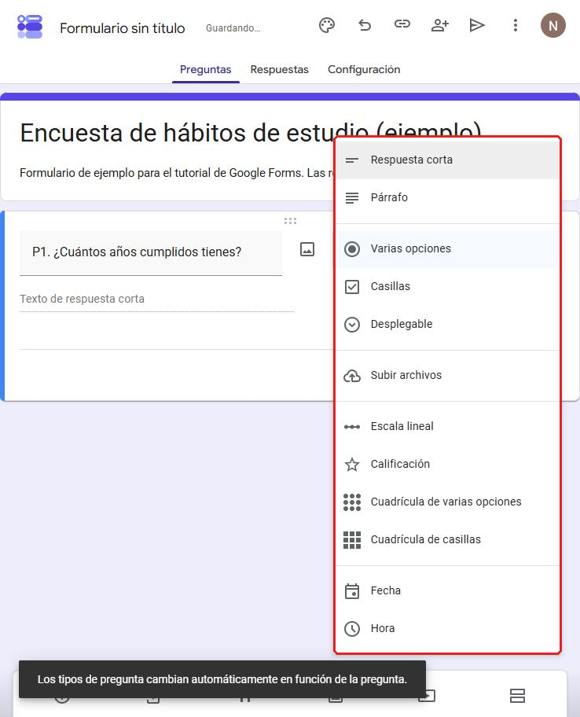
:::
::::

::: {.callout-important}
## Mide al nivel más alto posible
Si preguntas la edad exacta (razón), después puedes agruparla en tramos (ordinal). Al revés no se puede.
:::

### Baterías de preguntas: la cuadrícula

:::: {.columns}
::: {.column width="50%"}
Cuando varias afirmaciones comparten la misma escala, como "Muy en desacuerdo … Muy de acuerdo", usa **Cuadrícula de varias opciones**. Las **filas** (1) son los ítems y las **columnas** (2) son las categorías de respuesta.

Cada fila es una **variable ordinal distinta**: en la base descargada, cada ítem aparece en su propia columna. Activa *Solicitar una respuesta en cada fila* si todos los ítems deben responderse.
:::
::: {.column width="4%"}
:::
::: {.column width="46%"}
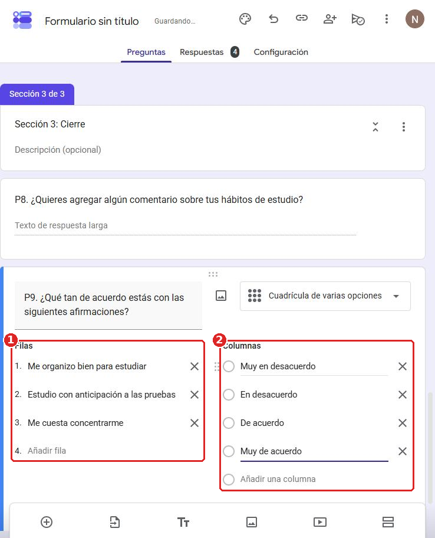
:::
::::

::: {.callout-tip}
## ¿Ordenar las opciones aleatoriamente?
En el menú ⋮ de cada pregunta está la opción **Ordenar las opciones aleatoriamente**. En preguntas **nominales con muchas opciones** ayuda a reducir el sesgo de que la gente elija las primeras. **Nunca** la uses en preguntas ordinales, porque se pierde el orden de la escala.
:::

## Codificar las preguntas

Codificar es asignar un número a cada respuesta. Se decide **antes** de aplicar la encuesta y se anota en un **libro de códigos**, porque Google Forms guarda el **texto** de la opción y no un número:

| Variable | Pregunta | Códigos |
|:---|:---|:---|
| `dependencia` | P2. Tipo de establecimiento | 1 = Municipal · 2 = Part. subvencionado · 3 = Part. pagado · 4 = SLEP · 96 = Otro |
| `educ_madre` | P4. Nivel educacional de la madre | 1 = Básica incompleta … 5 = Postgrado |
| `trabaja` | P6. ¿Trabaja? | 1 = Sí · 0 = No |
| *(todas)* | — | -99 = No responde · -88 = No aplica |

Tres reglas:

- **El orden de las opciones es el orden de los códigos.** Escribe las opciones ordinales de menor a mayor.
- **Agrega "Otro"** para que las categorías cubran todos los casos.
- **Casillas = una variable por opción** (0 = no marcó, 1 = marcó).

## Hacer preguntas obligatorias

:::: {.columns}
::: {.column width="55%"}
Activa el interruptor **Obligatorio** (1). La pregunta queda con un asterisco rojo y el formulario no avanza si está vacía.

Desde los tres puntos (⋮) puedes agregar **Validación de respuestas** (2). Por ejemplo, exigir que la edad sea un número entre 15 y 99. Si alguien escribe "veinte", Forms muestra un error y no deja continuar.

Las **preguntas filtro siempre deben ser obligatorias**. Las preguntas sensibles, en cambio, conviene dejarlas opcionales.
:::
::: {.column width="45%"}
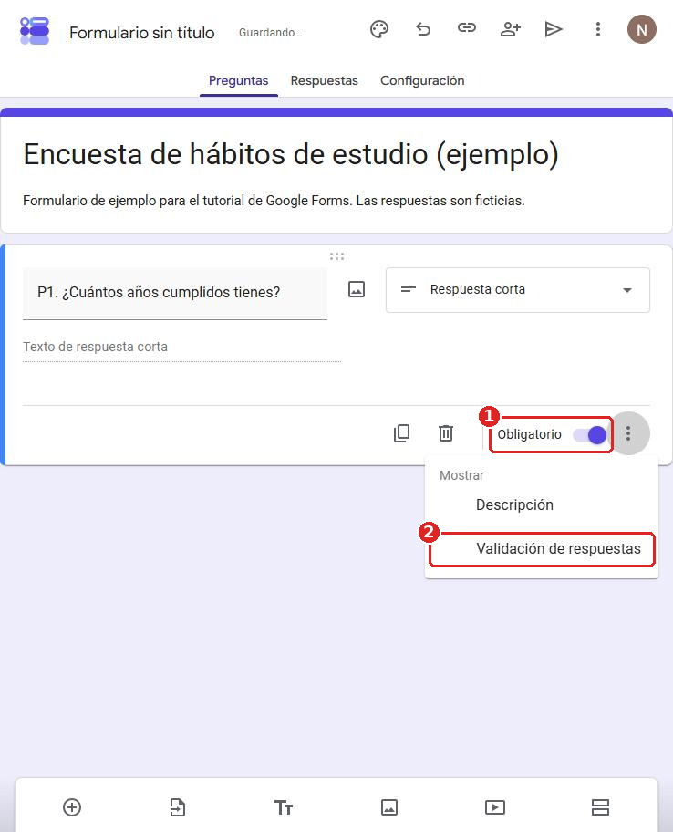
:::
::::

## Preguntas filtro

Una pregunta filtro decide qué preguntas ve cada persona. En el ejemplo, solo quien **trabaja** responde cuántas horas trabaja:

```{mermaid}
%%| fig-align: center
flowchart LR
  A["Sección 1<br/>P6. ¿Trabajas?"] -->|Sí| B["Sección 2<br/>P7. Horas de trabajo"]
  A -->|No| C["Sección 3<br/>Cierre"]
  B --> C
  style A fill:#efedfd,stroke:#4b3fd1
  style B fill:#e6f6ef,stroke:#10956b
  style C fill:#fdeef0,stroke:#d1495b
```

Se hace en tres pasos:

1. **Divide el formulario en secciones** con el botón *Añadir sección* de la barra de herramientas. La pregunta filtro debe quedar al final de su sección.
2. En la pregunta filtro, abre ⋮ y activa **Ir a la sección según la respuesta**.
3. **Elige el destino de cada opción**: Sí → sección 2, No → salta a la sección 3.

:::: {.columns}
::: {.column width="48%"}
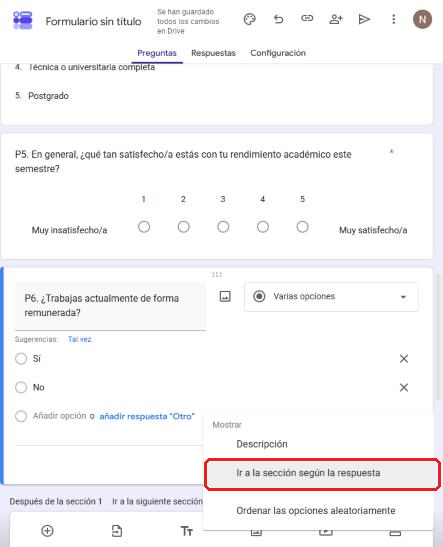
:::
::: {.column width="4%"}
:::
::: {.column width="48%"}
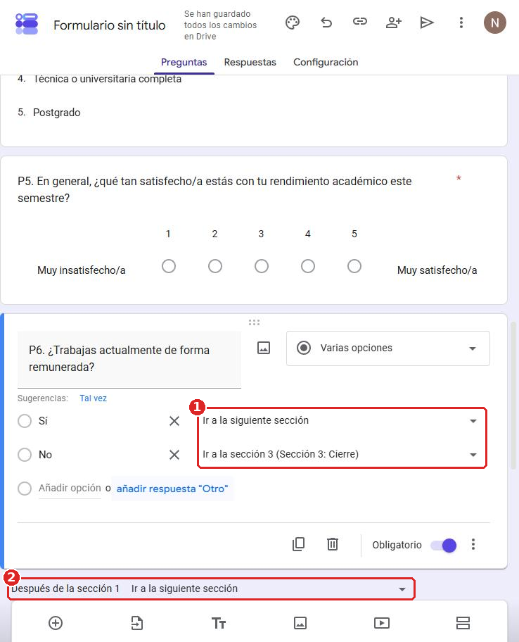
:::
::::

::: {.callout-tip}
## Prueba todos los caminos
Antes de difundir la encuesta, respóndela una vez con "Sí" y otra con "No" para comprobar que los saltos funcionan.
:::

### Un uso clave: el consentimiento informado

:::: {.columns}
::: {.column width="55%"}
La misma lógica sirve para el **consentimiento informado**, un requisito ético habitual en encuestas universitarias:

1. Pon en la **primera sección** el texto del consentimiento (objetivo del estudio, uso de los datos, carácter voluntario y anónimo).
2. Agrega una pregunta obligatoria: **¿Aceptas participar en este estudio?** (Sí / No).
3. Configura el salto: **Sí → Ir a la siguiente sección** y **No → Enviar formulario**.

Así, quien no acepta termina la encuesta sin ver ninguna pregunta.
:::
::: {.column width="45%"}
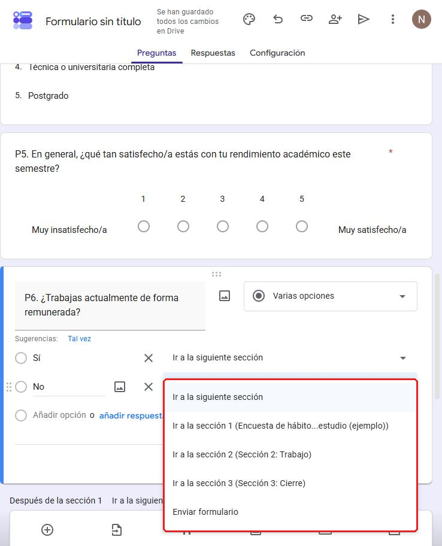
:::
::::

## Antes de publicar

### Revisa la configuración de respuestas

:::: {.columns}
::: {.column width="52%"}
En la pestaña **Configuración → Respuestas** se decide cómo se recogen los datos:

1. **Recopilar direcciones de correo electrónico.** Si la encuesta es **anónima**, déjalo en *No recoger*; si no, la base guardará el correo de cada persona.
2. **Permitir modificar las respuestas.** Permite corregir una respuesta después de enviarla. Normalmente conviene dejarlo **desactivado**.
3. **Limitar a 1 respuesta.** Evita que una persona responda dos veces, pero **obliga a iniciar sesión** con una cuenta de Google. Eso puede dejar fuera a parte de la muestra.
:::
::: {.column width="4%"}
:::
::: {.column width="44%"}
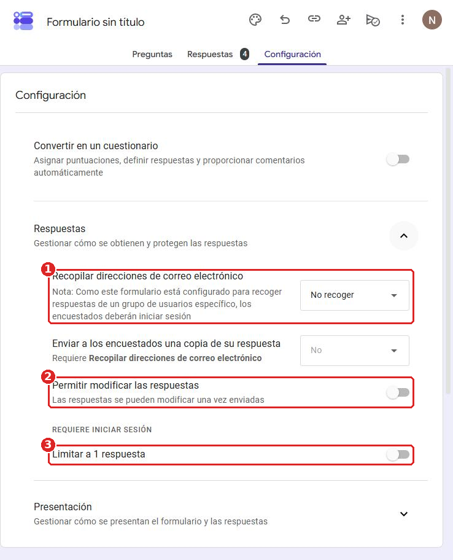
:::
::::

### Prueba la encuesta con la vista previa

:::: {.columns}
::: {.column width="55%"}
En el menú ⋮ (arriba a la derecha) elige **Vista previa**. Ahí ves el formulario tal como lo verá quien responde. Úsala para recorrer todos los caminos de los filtros.

Si envías respuestas de prueba, **bórralas antes de difundir la encuesta**: *Respuestas → ⋮ → Eliminar todas las respuestas*. Si no las borras, quedan mezcladas con los datos reales.
:::
::: {.column width="45%"}
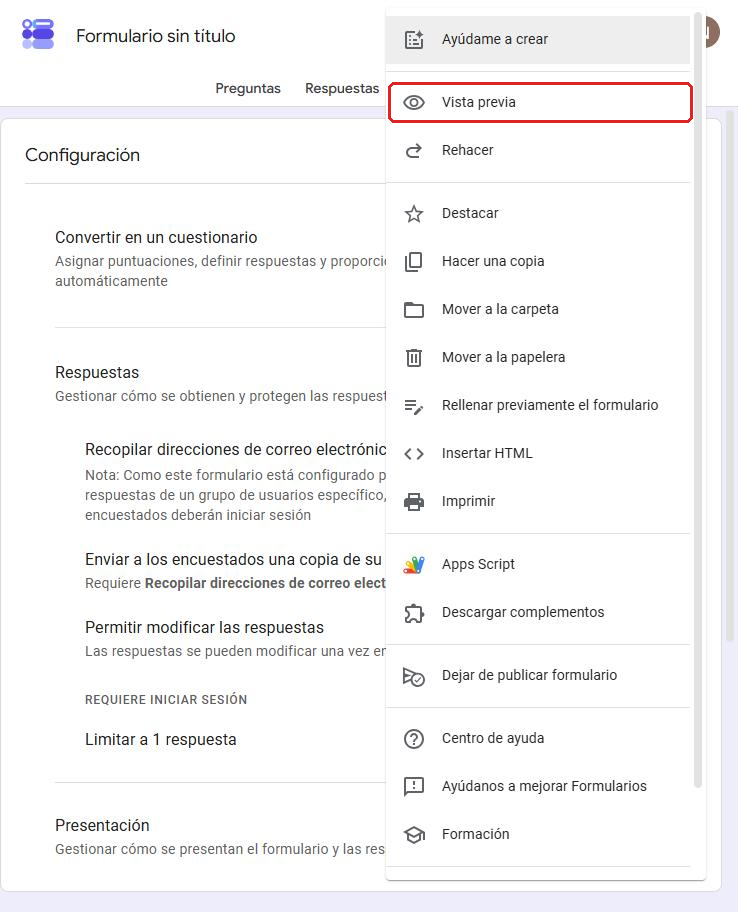
:::
::::

Cuando todo esté listo, usa el botón **Publicar** y copia el **enlace de encuestado/a** para difundirlo.

## Cerrar la encuesta

:::: {.columns}
::: {.column width="55%"}
Cuando termine el trabajo de campo, haz clic en el ícono de publicación (el avión de papel) y desactiva **Se aceptan respuestas**. Quien abra el enlace verá un aviso de que el formulario ya no acepta respuestas.

También puedes programarlo con **Definir fecha de cierre o límite de respuestas**. El formulario se cierra solo en una fecha determinada o al llegar a un número de respuestas, lo que sirve para controlar el tamaño de la muestra.
:::
::: {.column width="45%"}
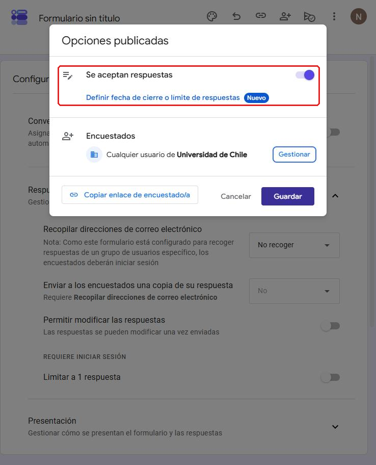
:::
::::

## Descargar la base de datos

Cuando lleguen respuestas, ve a la pestaña **Respuestas**, abre el menú ⋮ y elige **Descargar respuestas (.csv)**. Otra opción es *Vincular con Hojas de cálculo*: crea una planilla de Google que se actualiza sola con cada respuesta nueva.

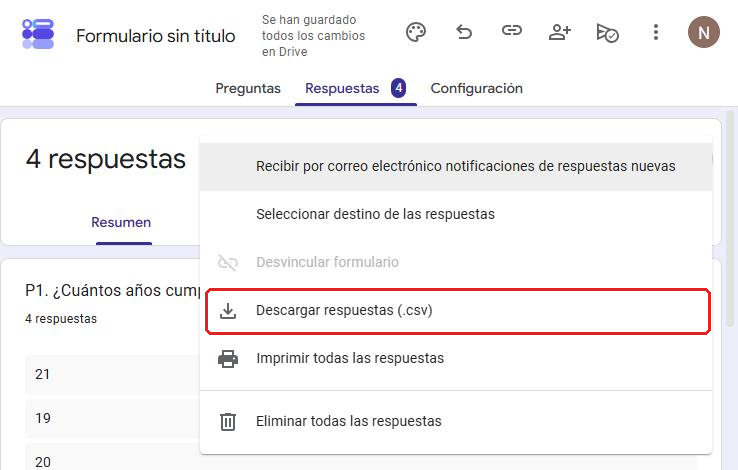{width=80%}

::: {.callout-note}
## Llega un .zip
El archivo se descarga comprimido. Descomprímelo para obtener el `.csv`.
:::

Así se ve la base descargada:

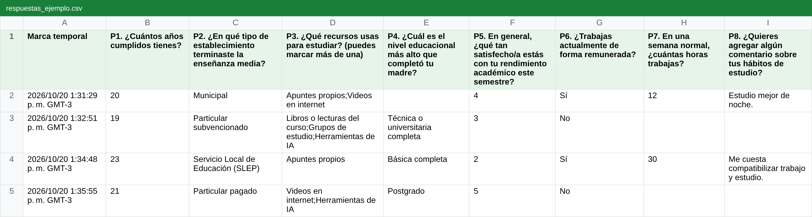

Fíjate en tres cosas:

- **Una fila por persona y una columna por pregunta.** La primera columna es la fecha y hora del envío.
- **Las respuestas vienen como texto**, por eso necesitas el libro de códigos. Solo la escala lineal (P5) viene como número.
- **Las celdas vacías** pueden significar "no respondió" (P4, fila 2) o "no le correspondía por el filtro" (P7, filas 3 y 5).

## Después: limpiar la base

::: {.callout-important}
## Google Forms no limpia los datos
Forms solo recolecta las respuestas. La base descargada se limpia **después, en otro software** (R, Stata, SPSS o Excel). Ahí se cambian los nombres de las columnas por nombres cortos de variable, se reemplaza el texto de cada respuesta por su código según el libro de códigos y se separan las preguntas de casillas en una variable 0/1 por opción. También se codifican las **celdas vacías**: si la persona no respondió, se marca como dato perdido (`NA` o -99); si la pregunta no le correspondía por el filtro, se marca como *no aplica* (-88).
:::
